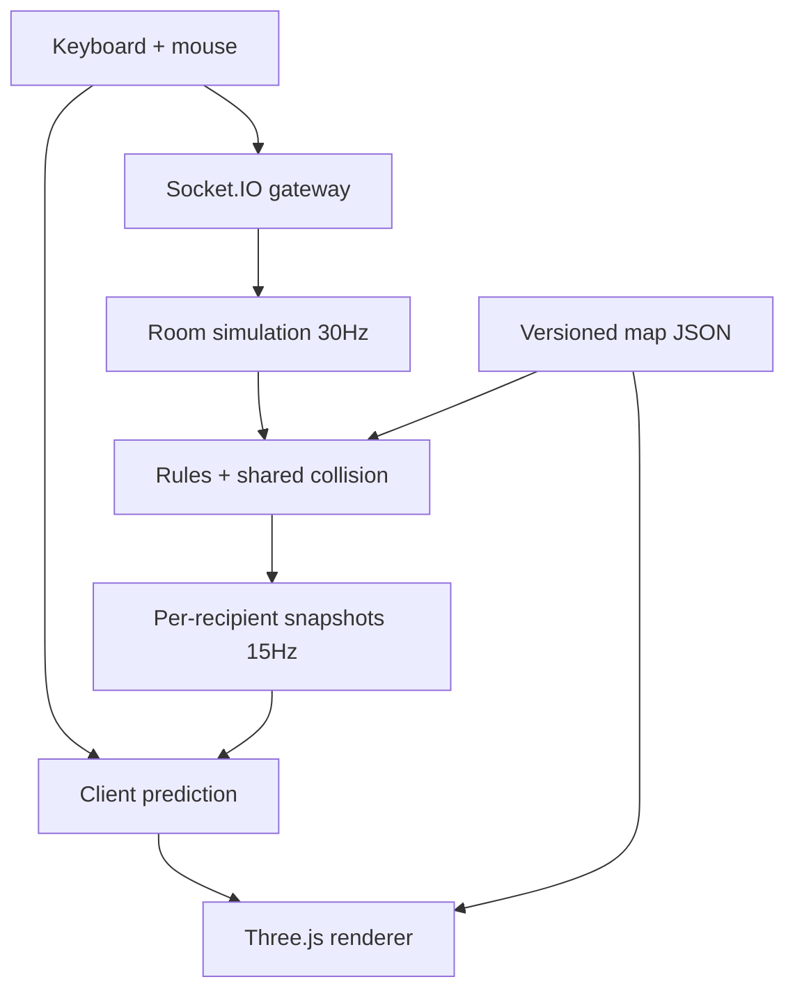

# Kiến trúc kỹ thuật

## Stack đề xuất

TypeScript cả frontend/backend để dùng chung contract và mô phỏng. Client Vite + Three.js + DOM/CSS (không cần React cho MVP); Node.js + Express + Socket.IO server; npm workspaces; Vitest cho unit/integration, Playwright cho smoke. Chọn Node LTS được Vite hỗ trợ, pin exact version trong .nvmrc, commit package-lock.json. Không chọn phiên bản thư viện tùy tiện; xác nhận tương thích khi bootstrap.

Three.js chỉ render, không làm authority. Mô phỏng shared thuần TS, capsule/box có yaw, timestep cố định. Từ 27/11/2026, map mặc định là `packages/shared/maps/vietnam-village.json`: heightfield trích từ terrain GLB, collider tĩnh và định nghĩa bản lề cửa. Server đọc JSON, không đọc GLB và không cần thêm physics engine. `terrain.ts` lấy cao độ đúng tam giác; `doors.ts` tính góc/collider cửa và dừng animation khi gặp capsule. Mỗi Room clone world và DoorState riêng, cập nhật trước movement/LOS, gửi góc trong snapshot. Client prediction dùng cùng hàm với trạng thái cửa server; Three.js chỉ nội suy hình ảnh.



## Cấu trúc repository

```text
folk-tag/
  apps/
    client/src/
      main.ts
      core/             # renderer, assets, frame loop
      input/            # pointer lock, controls
      world/            # map loader, instances, debug colliders
      player/           # FPS camera, prediction, remote interpolation
      network/          # transport, snapshot buffer, reconnect
      ui/               # lobby, HUD, results, accessibility
      audio/            # footsteps and ambience
    client/public/models/
    server/src/
      index.ts          # health, socket bootstrap
      rooms/            # lobby, room lifetime, sessions
      game/             # tick loop, phases, capture/rescue, guard policy
      network/          # validate payloads, recipient filtering
  packages/shared/src/
    protocol.ts         # wire DTOs, version
    rules.ts            # gameplay constants, units
    movement.ts         # pure fixed-step simulation
    collision.ts        # static AABB queries, LOS, guard boundaries
    map.ts              # schema, map validation
  packages/shared/maps/village-v1.json
  assets/blender/       # source .blend files, license registry
  tests/                # integration & E2E
  docs/                 # these Markdown files
  .github/workflows/ci.yml
  package.json
```

No import three/socket.io from shared. Server owns roles, map, timer, pos, stamina, jail, hide, results. Client owns rendering, camera, input sampling, UI. Shared map/rules/version locked by both contributors. Use JSON map metadata as source of truth; art references object ID, not collision derived from mesh.

## Simulation

- Fixed step 1/30 sec using monotonic clock on server; snapshot every other tick (15Hz). Cap catch-up 5 steps; under overload record metric, never grant extra game time (deadline is monotonic absolute time). Dispose room timer on end/empty.
- Input seq increments per client tick; latest held movement state used per step, jump/capture edge IDs deduplicated; clear input if no packet 250ms. Server ack last processed seq. Never accept client position or reported capture target as truth.
- Collision: ground y=0, bounds x/z [-40,40], swept capsule against static boxes via conservative substeps ≤0.15m; vertical ground/fence collision, prevent tunneling, normalize direction. Crouch stand only if clear. Guard constraint checked continuously with radius; hidden volume uses capsule center. LOS uses segment vs static AABB and active jail bars proxy; rescue anchor must reachable outside proxy.
- Local player prediction from shared simulation with 30Hz accumulator, render 60Hz; on snapshot reset authoritative pos/state, replay pending unacknowledged inputs; smooth only visual correction <0.5m, snap on teleport/large mismatch. Use interpolated remote snapshots with ~100ms delay; no extrapolation >100ms. Missing inputs/visibility resets clear interpolation buffer.
- No lag compensation initially; test high latency, tune range/cooldown. Do not use extrapolated client data for capture.
- Reliable room commands use acknowledgements/request IDs; stale movement/snapshots can be dropped. Recover using current full snapshot rather than relying on event replay.

## Data flow & UI

Client loads map and GLBs; when ready sends map hash + protocol version; server rejects mismatches before ready. Render own hands optional, camera anchored to capsule. Remote character animations derived from horizontal speed/crouch/grounded. HUD timer from authoritative remaining ms (smooth locally), team count, stamina, rescue progress, immunity, objective. Roster shows names/team/state but never hidden enemy position. Opponent hidden => remove mesh/audio/name immediately; avoid ghost marker.

## Hosting and security

One process instance (in-memory rooms); build static client and serve same origin via Express/reverse proxy, HTTPS/WSS, configurable PORT/origin. Use environment variables only for secrets; .env.example placeholders. `/healthz` reports process status only. Validate all input (finite bounded yaw/pitch, seq, booleans, payload size, nickname length 2–20); session random opaque token, rate limits join/command/input, no arbitrary room broadcast. Escape user strings via textContent. Deny role forgery, impossible actions, path traversal; never log tokens. Idle lobbies expire after 15 min, maximum room count configurable (start 20); test before raising.

No DB, Redis, Kafka or microservice during MVP. Scale later via sticky sessions/room ownership; do not assume adding a Socket.IO adapter distributes simulation.

## Performance budgets (targets)

Initial compressed download ≤15MB; draw calls ≤150 typical; triangles visible ≤150k; devicePixelRatio capped 1.5; one directional shadow light (or baked/no shadows low mode), ambient/hemisphere light; instance trees/fences/grass, share materials, frustum culling, dispose GPU resources. Target 60fps at 1080p on recorded test desktop, low mode ≥30fps. Server tick p95 <20ms at 5 rooms ×6 clients; measure with headless scripted client before expanding.

## Official references

- https://threejs.org/docs/pages/GLTFLoader.html
- https://threejs.org/docs/
- https://socket.io/docs/v4/rooms/
- https://socket.io/docs/v4/delivery-guarantees/ — ordering does not imply guaranteed delivery; snapshots and reconnect are necessary.
- https://vite.dev/guide/
- https://docs.blender.org/manual/en/latest/addons/import_export/scene_gltf2.html
