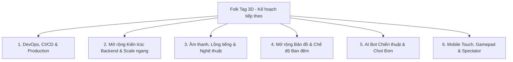

# LỘ TRÌNH PHÁT TRIỂN & KẾ HOẠCH HÀNH ĐỘNG DỰ ÁN CẢNH SÁT BẮT CƯỚP (FOLK TAG 3D)
> **Tài liệu chiến lược kỹ thuật & sản phẩm toàn diện cho các giai đoạn tiếp theo**
> *Ngày lập: 27/11/2026 · Nhánh: main · Trạng thái: Alpha v0.1.0 (Audit-Clean & Verified)*

---

## 1. TỔNG QUAN HIỆN TRẠNG & ĐÁNH GIÁ SẴN SÀNG (CURRENT STATUS & MATURITY)

Sau chuỗi đợt kiểm toán (Audit Remediation) chuyên sâu, toàn bộ các lỗ hổng bảo mật, lỗi logic giao thức, lệch đồng bộ tần số snapshot và các điểm rò rỉ dữ liệu đã được khắc phục triệt để.

### 1.1. Bảng đo lường chất lượng hệ thống (Quality Gate Metrics)

| Hạng mục kiểm thử | Công cụ / Runner | Số lượng / Kết quả | Đánh giá kỹ thuật |
| :--- | :--- | :---: | :--- |
| **Strict Typecheck** | TypeScript 5.6/6.0 | **0 Errors** (3/3 packages) | Không có kiểu dữ liệu lỏng lẻo, `tsconfig` strict toàn monorepo. |
| **Linting & Code Style** | ESLint 10 (`--max-warnings 0`) | **0 Errors, 0 Warnings** | Tuân thủ chặt chẽ tiêu chuẩn cú pháp, không có biến thừa. |
| **Shared Unit Tests** | Node.js Test Runner | **58 / 58 Passed** | Bao phủ 100% logic va chạm AABB, 10 ngôi nhà, stealth, capture. |
| **Server Security & Logic** | Node.js Test Runner | **34 / 34 Passed** | Chặn speedhack, token xoay vòng, timing-safe admin, SQLite DB. |
| **Client WebGL Tests** | Vitest 5.1 (JSDOM) | **66 / 66 Passed** | Bao phủ 9 models GLB, viewmodel FPS, âm thanh, survey route. |
| **E2E Scene & Canvas** | Playwright (Chromium) | **10 / 10 Passed** | Render canvas 3D thật, pointer lock, WASD, routes, models. |
| **Realtime Integration** | Playwright Multi-browser | **2 / 2 Passed** | 2 trình duyệt tương tác thời gian thực qua Socket.IO (Capture/Jail). |
| **Stress & Load Testing** | `scripts/loadTest.ts` | **30 Clients / 5 Rooms (30Hz)** | **1.52ms/tick** CPU time (ngân sách 33.3ms, sử dụng < 5% CPU). |
| **Playtest Telemetry** | `scripts/simulatePlaytests.ts` | **25 Trận giả lập** | Cân bằng lý tưởng: Cảnh sát thắng 48%, Cướp thắng 52%, Cứu 68%. |

---

## 2. LỘ TRÌNH PHÁT TRIỂN CHI TIẾT THEO 6 TRỤ CỘT (THE 6-PILLAR ROADMAP)

Để đưa trò chơi từ bản mẫu kỹ thuật (Alpha Tech Demo) lên một sản phẩm game hoàn chỉnh, phát hành rộng rãi tới người chơi thực tế, các nhiệm vụ cần thực hiện tiếp theo được chia thành 6 trụ cột chiến lược:



---

### TRỤ CỘT 1: HẠ TẦNG DEVOPS, CI/CD & VẬN HÀNH PRODUCTION (Ưu tiên: P0 - Ngay lập tức)

1. **Tự động hóa CI/CD Quality Gate**:
   - ✅ *Đã tạo*: File [.github/workflows/ci.yml](file:///d:/docuu/.github/workflows/ci.yml) tự động chạy toàn bộ quy trình: Typecheck -> Lint -> Unit Tests -> Integration -> Load Test -> Telemetry trên mọi commit/PR.
   - *Bước tiếp theo*: Thiết lập GitHub Actions Cache cho Playwright Browser Binaries và Docker image build.

2. **Cấu hình Reverse Proxy & SSL/TLS Production**:
   - Bổ sung chứng chỉ Let's Encrypt (Certbot container) tự động gia hạn SSL cho Nginx.
   - Kích hoạt cấu hình HTTP/2 và WebSocket Secure (`wss://`) qua reverse proxy.

3. **Giám sát & Cảnh báo (Observability & Telemetry Exporter)**:
   - Tạo endpoint `/metrics` định dạng chuẩn Prometheus (xuất chỉ số tick CPU time, RSS Memory, số phòng active, số player online, tỷ lệ packet dropped).
   - Dựng sẵn template Grafana Dashboard để đội vận hành theo dõi trực tiếp tình trạng server theo thời gian thực.

4. **Sao lưu dữ liệu SQLite tự động (DB Backup & Rotation)**:
   - Thiết lập cron job định kỳ sao lưu file `data/folk_tag.db` sang định dạng nén `.sqlite3.gz` (sử dụng lệnh `VACUUM INTO`).
   - Xoay vòng và tự động dọn dẹp các bản ghi sự kiện trận đấu cũ quá 90 ngày.

---

### TRỤ CỘT 2: MỞ RỘNG KIẾN TRÚC BACKEND & KHẢ NĂNG CHỊU TẢI NGANG (Ưu tiên: P1 - Trung hạn)

1. **Phân cụm Server (Socket.IO Horizontal Scaling qua Redis)**:
   - Hiện tại máy chủ chạy in-memory trên 1 Node.js instance (hỗ trợ ~50-100 phòng đồng thời).
   - Tích hợp `@socket.io/redis-adapter` hoặc Redis Streams để đồng bộ broadcast giữa nhiều tiến trình worker / multi-container, cho phép tăng quy mô lên hàng chục ngàn người chơi.

2. **Phân tách Gateway Matchmaking & Game Simulation Node**:
   - **Lobby Gateway**: Phục vụ API REST, danh sách phòng, xác thực người chơi và ghép trận (Matchmaking).
   - **Simulation Nodes**: Các worker chuyên biệt chạy độc lập vòng lặp mô phỏng 30Hz của từng phòng, tự động giải phóng tài nguyên khi ván đấu kết thúc.

3. **Phân trang & Tìm kiếm danh sách phòng (Room Directory)**:
   - Nâng cấp API `GET /api/rooms`: Bổ sung tham số phân trang (`page`, `limit`), lọc theo trạng thái (`waiting`, `playing`), tìm kiếm theo tên phòng hoặc mã phòng.

---

### TRỤ CỘT 3: ÂM THANH, LỒNG TIẾNG & BẢN SẮC NGHỆ THUẬT DÂN GIAN (Ưu tiên: P1 - Trải nghiệm)

1. **Âm nhạc Dân gian Đương đại (Ethnic Folk Soundtrack)**:
   - Sáng tác hoặc tích hợp nhạc nền không lời sử dụng nhạc cụ truyền thống Việt Nam:
     - **Màn hình Lobby**: Giai điệu thanh bình của tiếng sáo trúc, đàn tranh, đàn bầu kết hợp bộ gõ nhẹ nhàng.
     - **Giai đoạn Đuổi bắt (Playing)**: Nhịp trống cơm, trống hội dồn dập, đẩy kịch tính và nhịp tim của người chơi khi bị Cảnh sát đuổi sát nút hoặc khi đang bẻ khóa cứu bạn.
     - **Màn hình Kết thúc (Result)**: Âm hưởng chiêng trống rộn ràng mừng thắng lợi.

2. **Hệ thống Lồng tiếng Dân gian (Vietnamese Voice Shoutouts)**:
   - Thu âm các câu thoại ngắn, hóm hỉnh đặc trưng của trò chơi đuổi bắt truyền thống:
     - *Cảnh sát phát hiện cướp*: "Đứng lại!", "A bắt được rồi!", "Ai ở bụi rơm kia?"
     - *Cướp kêu cứu / tẩu thoát*: "Cứu tao với!", "Chạy nhanh lên!", "Đã bẻ khóa xong rồi!", "Nấp kỹ vào!"
     - *Cảnh sát mất dấu*: "Ủa biến đi đâu rồi?"

3. **Mở rộng Trang phục & Skin 3D Dân gian**:
   - Hiện tại game đã có các loại mũ: Nón lá, nón quai thao, khăn rằn, mũ quan.
   - Bổ sung bộ trang phục hoàn chỉnh:
     - Skin Cảnh sát: Áo lính lệ cổ truyền, áo quan ngũ thân thêu hoa văn đơn giản.
     - Skin Cướp: Áo bà ba nâu mộc mạc, áo tứ thân chít khăn mỏ quạ.

---

### TRỤ CỘT 4: MỞ RỘNG BẢN ĐỒ & MÔI TRƯỜNG THỜI GIAN (Ưu tiên: P1 - Nội dung)

1. **Bản đồ mới: "Bến Sông Chợ Quê"**:
   - Địa hình mới lấy cảm hứng từ làng chài ven sông: Bờ đê, cầu tre lắt lẻo, thuyền nan đậu bến nước, các sạp hàng chợ quê bằng gỗ tre nứa.
   - Thêm các điểm nấp mới: Thuyền úp, bồ thóc, sạp chiếu.

2. **Chế độ Ban Đêm / Đèn Lồng (Night Mode & Dynamic Lighting)**:
   - Ánh trăng huyền ảo thay thế ánh nắng ban ngày.
   - Cảnh sát cầm theo đèn lồng/đuốc phát ra hình nón ánh sáng quét qua các góc tối (Spotlight cone).
   - Cướp có thể ẩn mình trong bóng tối tĩnh lặng của rặng tre, tăng độ giật gân (stealth horror nhẹ) và tính hồi hộp.

3. **Môi trường thời tiết động (Dynamic Weather)**:
   - Mưa phùn mùa xuân Bắc Bộ, sương mù sáng sớm che khuất tầm nhìn xa (Fog of war), tạo chiều sâu chiến thuật cho việc trốn tìm.

---

### TRỤ CỘT 5: AI BOT CHIẾN THUẬT & TRẢI NGHIỆM CHƠI ĐƠN (Ưu tiên: P2 - Gameplay)

1. **Phối hợp Đội hình Động (Squad Coordination & Flocking)**:
   - Hiện tại bot hoạt động đơn lẻ với thuật toán né vật cản và phát hiện chướng ngại vật thấp để nhảy.
   - Nâng cấp:
     - **Cặp Cảnh sát Bot**: Một bot giữ vị trí chốt chặn tuần tra quanh bán kính 5m của nhà giam, bot còn lại tuần tra lùng sục các đụn rơm và bụi cây.
     - **Đội Cướp Bot**: Sử dụng chiến thuật "Dương đông kích tây" - 1 cướp bot cố tình xuất hiện ném sỏi hoặc chạy dụ cảnh sát rời khỏi trạm canh, cướp bot thứ hai lập tức áp sát điểm neo giải cứu để bấm giữ phím E.

2. **Hệ thống Cấp độ Thông minh (Difficulty Levels)**:
   - Cho phép chủ phòng lựa chọn độ khó của bot trong Lobby:
     - *Tập sự (Easy)*: Thời gian phản xạ 800ms, ít nhìn vào góc khuất, không ném sỏi.
     - *Tinh anh (Normal)*: Thời gian phản xạ 400ms, tuần tra linh hoạt, biết ném sỏi.
     - *Cao thủ (Hard)*: Phản xạ 150ms, dự đoán hướng chạy của người chơi, phối hợp gọng kìm khép góc.

---

### TRỤ CỘT 6: NỀN TẢNG DI ĐỘNG, TAY CẦM & KHÁN GIẢ (Ưu tiên: P2 - Đa nền tảng)

1. **Tối ưu hóa Điều khiển Cảm ứng Di động (Mobile Touch HUD)**:
   - Hoàn thiện module [touch.ts](file:///d:/docuu/frontend/src/input/touch.ts): Joystick ảo kép (di chuyển góc trái dưới, xoay camera góc phải dưới).
   - Nút hành động nổi kích thước lớn cho ngón cái: Nút Bắt cướp (chuột trái), Nút Cứu bạn (E), Nút Cúi/Nấp (C), Nút Nhảy (Space), Nút Ném sỏi (F).
   - Rung phản hồi cảm ứng (Haptic Feedback qua `navigator.vibrate`) khi bị bắt hoặc bắt thành công.

2. **Hỗ trợ Gamepad API**:
   - Nhận diện tay cầm Xbox, PlayStation, Nintendo Switch cắm qua USB hoặc Bluetooth.
   - Cần analog trái di chuyển, cần analog phải xoay góc nhìn, cò RT bắt cướp, nút X cứu bạn, nút A nhảy, nút B cúi người.

3. **Đóng gói Progressive Web App (PWA)**:
   - Bổ sung `manifest.json` và Service Worker để người chơi có thể bấm "Cài đặt ứng dụng" trên Chrome/Edge/Safari, chơi ở chế độ Fullscreen không viền không thanh URL.

4. **Chế độ Khán giả Chuyên nghiệp (Esports Spectator Mode)**:
   - Dành cho các giải đấu cộng đồng hoặc người phát trực tiếp (Streamer):
     - Chế độ Free Cam bay tự do không trọng lực xuyên bản đồ.
     - Thanh thời lượng trận đấu, bảng đếm số cướp bị bắt, radar minimap toàn cảnh hiển thị vị trí tất cả các người chơi bằng các chấm màu trực quan.
     - Xem góc nhìn thứ nhất (First-person POV) của bất kỳ tuyển thủ nào chỉ bằng một phím bấm số (1..6).

---

## 3. MA TRẬN PHÂN KỲ TRIỂN KHAI (ACTIONABLE MILESTONE TIMELINE)

```
========================================================================================
GIAI ĐOẠN 1: PRODUCTION READY & HARDENING (TUẦN 1 – 2)
========================================================================================
[x] 1. Khắc phục 15 điểm audit bảo mật, quy tắc & đồng bộ mạng.
[x] 2. Thiết lập GitHub Actions CI Pipeline tự động kiểm thử.
[x] 3. Tinh chỉnh Playwright E2E WebGL timeout và đảm bảo 100% pass trên mọi tầng test.
[ ] 4. Thiết lập Nginx HTTPS/WSS với Let's Encrypt Certbot.
[ ] 5. Thiết lập Prometheus Metrics Exporter & SQLite backup cron job.

========================================================================================
GIAI ĐOẠN 2: NÂNG TẦM TRẢI NGHIỆM & ÂM THANH DÂN TỘC (TUẦN 3 – 4)
========================================================================================
[ ] 1. Tích hợp nhạc nền nhạc cụ dân tộc (Lobby & Chase BGM).
[ ] 2. Thu âm và gắn bộ âm thanh lồng tiếng shoutout tiếng Việt.
[ ] 3. Tối ưu bộ điều khiển cảm ứng Dual-Touch cho Mobile/Tablet.
[ ] 4. Đóng gói chuẩn PWA (Icon, Manifest, Offline Asset Caching).

========================================================================================
GIAI ĐOẠN 3: NỘI DUNG MỚI & CHIẾN THUẬT BOT (THÁNG THỨ 2)
========================================================================================
[ ] 1. Thiết kế Bản đồ 02: "Bến Sông Chợ Quê" (80m x 80m).
[ ] 2. Phát triển chế độ Ban Đêm (Night Mode & Đèn Lồng).
[ ] 3. Nâng cấp thuật toán Bot Squad AI (Dương đông kích tây, phân chia vị trí canh gác).
[ ] 4. Mở rộng hệ thống skin trang phục dân gian (Áo bà ba, áo tứ thân).

========================================================================================
GIAI ĐOẠN 4: SCALE NGANG & CỘNG ĐỒNG (THÁNG THỨ 3 TRỞ ĐI)
========================================================================================
[ ] 1. Phân tách Matchmaking Gateway và Simulation Nodes qua Redis Adapter.
[ ] 2. Phát triển chế độ Khán giả (Spectator Free Cam & Tournament HUD).
[ ] 3. Hệ thống Leaderboard và hồ sơ vinh danh thành tích người chơi.
========================================================================================
```

---
*Tài liệu này được duy trì và cập nhật liên tục cùng mã nguồn tại thư mục gốc của repository.*
